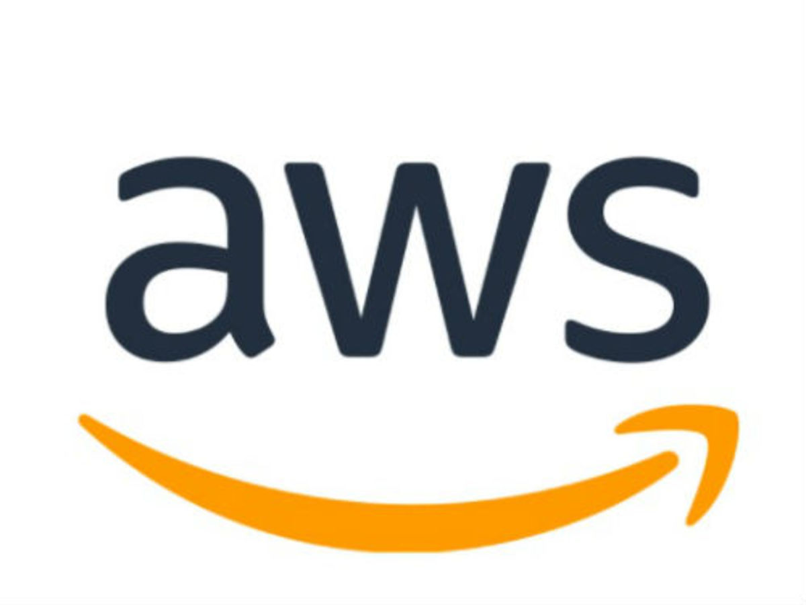
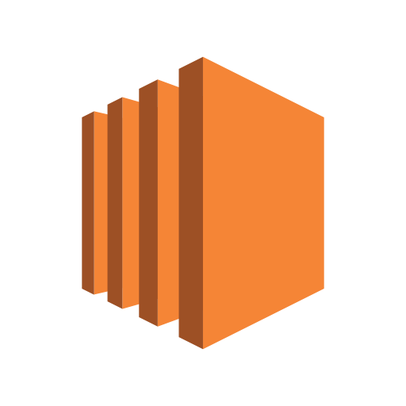
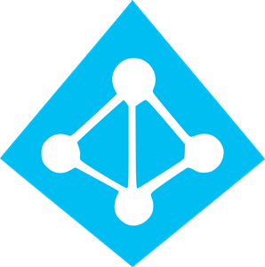
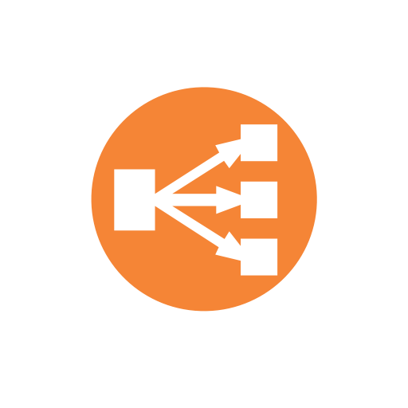
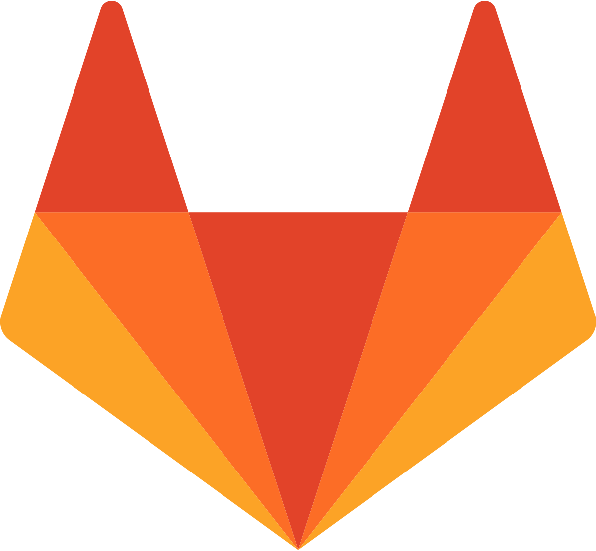
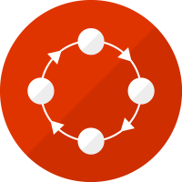
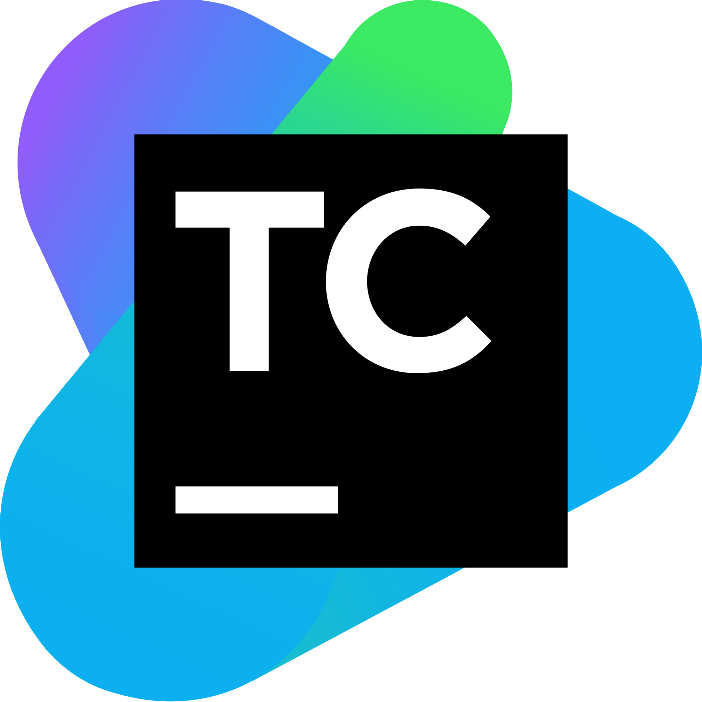
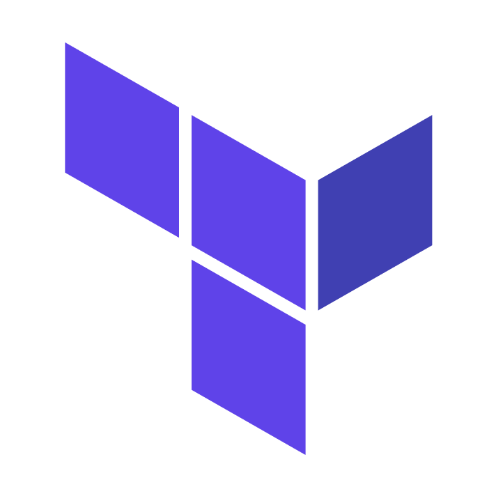
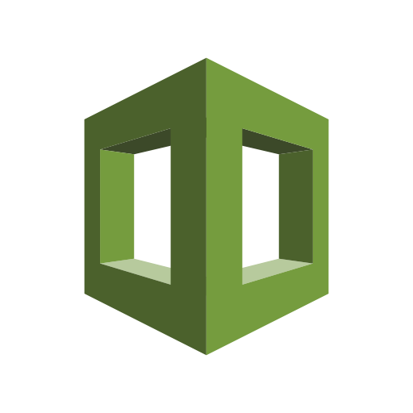

  

<h3 align="center">The infrastructure world, compared side by side.</h3>

  Cloud services, CI/CD, configuration management, provisioning, dashboards, monitoring and container orchestration — 
  the equivalent tools across vendors in one place, so you can pick the right one in minutes, not days.

  
  
  
  
  

  <b>If this saves you time, please ⭐ star the repo — it helps other engineers find it.</b>

---

## 📚 Contents

| | Section | What you'll find |
|---|---|---|
| ☁️ | [Cloud services](#cloud-services) | AWS ↔ Azure ↔ GCP ↔ OpenStack ↔ open source, service by service |
| 🔁 | [CI/CD](#cicd) | Jenkins, GitLab CI, GitHub Actions, CircleCI, Bamboo, Tekton, TeamCity |
| 🛠️ | [Configuration management](#configuration-management) | Ansible, Puppet, Chef, Salt |
| 🏗️ | [Provisioning (IaC)](#provisioning) | Terraform, OpenTofu, Pulumi, CloudFormation |
| 🐳 | [Container orchestration](#container-orchestration) | Kubernetes, OpenShift, Docker Swarm, Nomad |
| 📊 | [Dashboards](#dashboards) | Kibana, Grafana, ReportPortal |
| 📈 | [Monitoring](#monitoring) | Prometheus, Graphite, Nagios |
| 🤝 | [Contributing](#contributing) | How to add or fix a comparison |

**Legend:** ✅ yes · ❌ no · ⚠️ partially / with caveats (see the note in the cell)

> Some parts are opinionated — especially the *"best use case"* rows. Disagree? [Open an issue](https://github.com/b-irigui/infraverse/issues/new/choose) and make your case. Last full review: **November 2026**.

---

## ☁️ Cloud services

Every icon links to the service's official page.

<!-- prettier-ignore-start -->
<!-- markdownlint-disable -->
<table>
  <tr>
    <th></th>
    <th> AWS</th>
    <th> Azure</th>
    <th> GCP</th>
    <th> OpenStack</th>
    <th>🐧 Open source alternatives</th>
  </tr>
  <tr>
    <td align="center"><b>Compute</b></td>
    <td align="center"><a href="https://aws.amazon.com/ec2/"> <b>EC2</b></a></td>
    <td align="center"><a href="https://azure.microsoft.com/products/virtual-machines"> <b>Virtual Machines</b></a></td>
    <td align="center"><a href="https://cloud.google.com/compute"> <b>Compute Engine</b></a></td>
    <td align="center"><a href="https://docs.openstack.org/nova/latest/"> <b>Nova</b></a></td>
    <td align="center"><a href="https://www.ovirt.org/">oVirt</a> <a href="https://www.proxmox.com/en/proxmox-virtual-environment/overview">Proxmox VE</a> <a href="https://kubevirt.io/">KubeVirt</a></td>
  </tr>
  <tr>
    <td align="center"><b>Network</b></td>
    <td align="center"><a href="https://aws.amazon.com/vpc/"> <b>VPC</b></a></td>
    <td align="center"><a href="https://learn.microsoft.com/azure/virtual-network/"> <b>Virtual Network</b></a></td>
    <td align="center"><a href="https://cloud.google.com/vpc"> <b>VPC</b></a></td>
    <td align="center"><a href="https://docs.openstack.org/neutron/latest/"> <b>Neutron</b></a></td>
    <td align="center"><a href="https://www.openvswitch.org/">Open vSwitch</a> <a href="https://www.ovn.org/">OVN</a></td>
  </tr>
  <tr>
    <td align="center"><b>Object storage</b></td>
    <td align="center"><a href="https://aws.amazon.com/s3/"> <b>S3</b></a></td>
    <td align="center"><a href="https://azure.microsoft.com/products/storage/blobs"> <b>Blob Storage</b></a></td>
    <td align="center"><a href="https://cloud.google.com/storage"> <b>Cloud Storage</b></a></td>
    <td align="center"><a href="https://docs.openstack.org/swift/latest/"> <b>Swift</b></a></td>
    <td align="center"><a href="https://docs.ceph.com/en/latest/radosgw/">Ceph RGW</a> <a href="https://github.com/seaweedfs/seaweedfs">SeaweedFS</a> <a href="https://garagehq.deuxfleurs.fr/">Garage</a></td>
  </tr>
  <tr>
    <td align="center"><b>Block storage</b></td>
    <td align="center"><a href="https://aws.amazon.com/ebs/"> <b>EBS</b></a></td>
    <td align="center"><a href="https://learn.microsoft.com/azure/virtual-machines/managed-disks-overview"> <b>Managed Disks</b></a></td>
    <td align="center"><a href="https://cloud.google.com/persistent-disk"> <b>Persistent Disk</b></a></td>
    <td align="center"><a href="https://docs.openstack.org/cinder/latest/"> <b>Cinder</b></a></td>
    <td align="center"><a href="https://docs.ceph.com/en/latest/rbd/">Ceph RBD</a> <a href="https://longhorn.io/">Longhorn</a></td>
  </tr>
  <tr>
    <td align="center"><b>Machine images</b></td>
    <td align="center"><a href="https://docs.aws.amazon.com/AWSEC2/latest/UserGuide/AMIs.html"> <b>AMI</b></a></td>
    <td align="center"><a href="https://learn.microsoft.com/azure/virtual-machines/shared-image-galleries"> <b>Compute Gallery</b></a></td>
    <td align="center"><a href="https://cloud.google.com/compute/docs/images"><b>Images</b></a></td>
    <td align="center"><a href="https://docs.openstack.org/glance/latest/"> <b>Glance</b></a></td>
    <td align="center"><a href="https://github.com/canonical/cloud-init">cloud-init</a> + <a href="https://libguestfs.org/">libguestfs</a></td>
  </tr>
  <tr>
    <td align="center"><b>Identity</b></td>
    <td align="center"><a href="https://aws.amazon.com/iam/"> <b>IAM</b></a></td>
    <td align="center"><a href="https://www.microsoft.com/security/business/identity-access/microsoft-entra-id"> <b>Entra ID</b> (formerly Azure AD)</a></td>
    <td align="center"><a href="https://cloud.google.com/iam"> <b>Cloud IAM</b></a></td>
    <td align="center"><a href="https://docs.openstack.org/keystone/latest/"> <b>Keystone</b></a></td>
    <td align="center"><a href="https://www.keycloak.org/">Keycloak</a> <a href="https://www.freeipa.org/">FreeIPA</a></td>
  </tr>
  <tr>
    <td align="center"><b>Load balancer</b></td>
    <td align="center"><a href="https://aws.amazon.com/elasticloadbalancing/"> <b>Elastic Load Balancing</b></a></td>
    <td align="center"><a href="https://learn.microsoft.com/azure/load-balancer/"> <b>Load Balancer</b></a></td>
    <td align="center"><a href="https://cloud.google.com/load-balancing"> <b>Cloud Load Balancing</b></a></td>
    <td align="center"><a href="https://docs.openstack.org/octavia/latest/"> <b>Octavia</b></a></td>
    <td align="center"><a href="https://www.haproxy.org/">HAProxy</a> <a href="https://nginx.org/">NGINX</a> <a href="https://traefik.io/traefik/">Traefik</a> <a href="https://www.envoyproxy.io/">Envoy</a></td>
  </tr>
  <tr>
    <td align="center"><b>Event / data streaming</b></td>
    <td align="center"><a href="https://aws.amazon.com/kinesis/"> <b>Kinesis</b></a></td>
    <td align="center"><a href="https://azure.microsoft.com/products/event-hubs"><b>Event Hubs</b></a> + <a href="https://azure.microsoft.com/products/stream-analytics">Stream Analytics</a> for processing</td>
    <td align="center"><a href="https://cloud.google.com/pubsub"> <b>Pub/Sub</b></a></td>
    <td align="center">😢 No native service</td>
    <td align="center"><a href="https://kafka.apache.org/"> <b>Kafka</b></a> <a href="https://pulsar.apache.org/">Pulsar</a></td>
  </tr>
</table>
<!-- markdownlint-enable -->
<!-- prettier-ignore-end -->

---

## 🔁 CI/CD

### Platforms

<!-- prettier-ignore-start -->
<!-- markdownlint-disable -->
<table>
  <tr>
    <th></th>
    <th><a href="https://www.jenkins.io/"> Jenkins</a></th>
    <th><a href="https://docs.gitlab.com/ci/"> GitLab CI</a></th>
    <th><a href="https://github.com/features/actions">⚙️ GitHub Actions</a></th>
    <th><a href="https://circleci.com/"> CircleCI</a></th>
    <th><a href="https://www.atlassian.com/software/bamboo"> Bamboo</a></th>
    <th><a href="https://tekton.dev/"> Tekton / OpenShift Pipelines</a></th>
    <th><a href="https://www.jetbrains.com/teamcity/"> TeamCity</a></th>
  </tr>
  <tr>
    <td align="center"><b>Open source</b></td>
    <td align="center">✅</td>
    <td align="center">✅ Core (MIT); some features in paid tiers</td>
    <td align="center">❌ Runner is open source</td>
    <td align="center">❌</td>
    <td align="center">❌</td>
    <td align="center">✅</td>
    <td align="center">❌</td>
  </tr>
  <tr>
    <td align="center"><b>Deployment</b></td>
    <td align="center">Self-hosted</td>
    <td align="center">SaaS or self-managed</td>
    <td align="center">SaaS, self-hosted runners</td>
    <td align="center">SaaS or self-hosted (Server)</td>
    <td align="center">Self-hosted only (Data Center)</td>
    <td align="center">Any Kubernetes cluster</td>
    <td align="center">SaaS or on-premise</td>
  </tr>
  <tr>
    <td align="center"><b>Extensions</b></td>
    <td align="center">✅ Huge plugin ecosystem</td>
    <td align="center">✅ CI/CD Catalog components</td>
    <td align="center">✅ Actions Marketplace</td>
    <td align="center">✅ Orbs</td>
    <td align="center">✅ Atlassian Marketplace</td>
    <td align="center">✅ Tekton Hub / Artifact Hub</td>
    <td align="center">✅ JetBrains plugins</td>
  </tr>
  <tr>
    <td align="center"><b>Pipeline format</b></td>
    <td align="center">Groovy (Jenkinsfile)</td>
    <td align="center">YAML</td>
    <td align="center">YAML</td>
    <td align="center">YAML</td>
    <td align="center">Bamboo Specs (YAML or Java)</td>
    <td align="center">Kubernetes YAML (CRDs)</td>
    <td align="center">Kotlin DSL or UI</td>
  </tr>
  <tr>
    <td align="center"><b>Best use case</b> (opinionated)</td>
    <td align="center">Total freedom — if you don't mind maintaining it (and writing Groovy)</td>
    <td align="center">Your code already lives in GitLab</td>
    <td align="center">Your code already lives in GitHub</td>
    <td align="center">Fast, out-of-the-box hosted CI</td>
    <td align="center">You're all-in on Atlassian (Jira, Bitbucket)</td>
    <td align="center">Cloud-native, container-only pipelines on Kubernetes</td>
    <td align="center">Powerful CI, especially for JVM/.NET shops, open source not a requirement</td>
  </tr>
</table>
<!-- markdownlint-enable -->
<!-- prettier-ignore-end -->

### Configuration how-tos

| | Jenkins | GitLab CI | CircleCI | Bamboo |
|---|:---:|:---:|:---:|:---:|
| **Run a job on a specific node** | [Agent](cicd/jenkins/node.md) | [Runner](cicd/gitlab/node.md) | [Resource class / runner](cicd/circleci/node.md) | [Agent](cicd/bamboo/node.md) |

---

## 🛠️ Configuration management

<!-- prettier-ignore-start -->
<!-- markdownlint-disable -->
<table>
  <tr>
    <th></th>
    <th><a href="https://www.ansible.com/"> Ansible</a></th>
    <th><a href="https://www.puppet.com/"> Puppet</a></th>
    <th><a href="https://www.chef.io/"> Chef</a></th>
    <th><a href="https://saltproject.io/">🧂 Salt</a></th>
  </tr>
  <tr>
    <td align="center"><b>Open source</b></td>
    <td align="center">✅</td>
    <td align="center">⚠️ Since late 2024, Perforce no longer publishes open-source builds; the community fork <a href="https://voxpupuli.org/openvox/">OpenVox</a> stays fully open</td>
    <td align="center">⚠️ Source is Apache 2.0; official binaries need a license for commercial use</td>
    <td align="center">✅</td>
  </tr>
  <tr>
    <td align="center"><b>Architecture</b></td>
    <td align="center">Agentless (SSH/WinRM)</td>
    <td align="center">Server + agents</td>
    <td align="center">Server + agents</td>
    <td align="center">Master + minions, or agentless (salt-ssh)</td>
  </tr>
  <tr>
    <td align="center"><b>Language</b></td>
    <td align="center">YAML playbooks, written in Python</td>
    <td align="center">Puppet DSL, written in Ruby</td>
    <td align="center">Ruby DSL, written in Ruby</td>
    <td align="center">YAML + Jinja, written in Python</td>
  </tr>
  <tr>
    <td align="center"><b>Push vs. pull</b></td>
    <td align="center">Push (pull via ansible-pull)</td>
    <td align="center">Pull by default</td>
    <td align="center">Pull</td>
    <td align="center">Push (event bus)</td>
  </tr>
</table>
<!-- markdownlint-enable -->
<!-- prettier-ignore-end -->

---

## 🏗️ Provisioning (IaC)

> Many tools can provision infrastructure (Ansible included). This table focuses on tools built mainly for that purpose.

<!-- prettier-ignore-start -->
<!-- markdownlint-disable -->
<table>
  <tr>
    <th></th>
    <th><a href="https://developer.hashicorp.com/terraform"> Terraform</a></th>
    <th><a href="https://opentofu.org/">🟡 OpenTofu</a></th>
    <th><a href="https://www.pulumi.com/"> Pulumi</a></th>
    <th><a href="https://aws.amazon.com/cloudformation/"> CloudFormation</a></th>
  </tr>
  <tr>
    <td align="center"><b>Open source</b></td>
    <td align="center">⚠️ Source-available (BSL 1.1) since Aug 2023</td>
    <td align="center">✅ MPL 2.0, Linux Foundation fork of Terraform</td>
    <td align="center">✅ Apache 2.0</td>
    <td align="center">❌</td>
  </tr>
  <tr>
    <td align="center"><b>Language</b></td>
    <td align="center">HCL</td>
    <td align="center">HCL (drop-in compatible)</td>
    <td align="center">TypeScript, Python, Go, C#, Java, YAML</td>
    <td align="center">JSON or YAML</td>
  </tr>
  <tr>
    <td align="center"><b>Cloud agnostic</b></td>
    <td align="center">✅</td>
    <td align="center">✅</td>
    <td align="center">✅</td>
    <td align="center">❌ AWS only</td>
  </tr>
  <tr>
    <td align="center"><b>Written in</b></td>
    <td align="center">Go</td>
    <td align="center">Go</td>
    <td align="center">Go (+ language SDKs)</td>
    <td align="center">Managed AWS service</td>
  </tr>
  <tr>
    <td align="center"><b>Main advantage</b></td>
    <td align="center">Largest community and provider ecosystem</td>
    <td align="center">Terraform workflow under a truly open license, community governed</td>
    <td align="center">Real programming languages: loops, tests, IDE support</td>
    <td align="center">Deep AWS coverage, managed state and rollbacks</td>
  </tr>
</table>
<!-- markdownlint-enable -->
<!-- prettier-ignore-end -->

---

## 🐳 Container orchestration

<!-- prettier-ignore-start -->
<!-- markdownlint-disable -->
<table>
  <tr>
    <th></th>
    <th><a href="https://kubernetes.io/"> Kubernetes</a></th>
    <th><a href="https://www.redhat.com/en/technologies/cloud-computing/openshift"> OpenShift</a></th>
    <th><a href="https://docs.docker.com/engine/swarm/">🐋 Docker Swarm</a></th>
    <th><a href="https://developer.hashicorp.com/nomad">🟢 Nomad</a></th>
  </tr>
  <tr>
    <td align="center"><b>Open source</b></td>
    <td align="center">✅ Apache 2.0</td>
    <td align="center">⚠️ Commercial; upstream <a href="https://okd.io/">OKD</a> is open source</td>
    <td align="center">✅ Apache 2.0</td>
    <td align="center">⚠️ Source-available (BSL 1.1) since 2023</td>
  </tr>
  <tr>
    <td align="center"><b>Workload definition</b></td>
    <td align="center">YAML manifests (Helm, Kustomize)</td>
    <td align="center">Kubernetes YAML + Operators, Templates</td>
    <td align="center">Compose YAML</td>
    <td align="center">HCL job specs</td>
  </tr>
  <tr>
    <td align="center"><b>Runs</b></td>
    <td align="center">Containers (VMs via KubeVirt)</td>
    <td align="center">Containers and VMs</td>
    <td align="center">Containers</td>
    <td align="center">Containers, VMs, plain binaries, Java</td>
  </tr>
  <tr>
    <td align="center"><b>Learning curve</b></td>
    <td align="center">Steep</td>
    <td align="center">Steep, but batteries included</td>
    <td align="center">Gentle</td>
    <td align="center">Moderate</td>
  </tr>
  <tr>
    <td align="center"><b>Best use case</b> (opinionated)</td>
    <td align="center">The industry default for almost anything at scale</td>
    <td align="center">Enterprises that want Kubernetes with security, CI/CD and support built in</td>
    <td align="center">Small clusters for teams already using Docker Compose</td>
    <td align="center">Mixed workloads and teams invested in the HashiCorp stack</td>
  </tr>
</table>
<!-- markdownlint-enable -->
<!-- prettier-ignore-end -->

---

## 📊 Dashboards

<!-- prettier-ignore-start -->
<!-- markdownlint-disable -->
<table>
  <tr>
    <th></th>
    <th><a href="https://www.elastic.co/kibana"> Kibana</a></th>
    <th><a href="https://grafana.com/oss/grafana/"> Grafana</a></th>
    <th><a href="https://reportportal.io/"> ReportPortal</a></th>
  </tr>
  <tr>
    <td align="center"><b>Open source</b></td>
    <td align="center">✅ AGPLv3 option added in 2024; fork: <a href="https://opensearch.org/docs/latest/dashboards/">OpenSearch Dashboards</a></td>
    <td align="center">✅ AGPLv3</td>
    <td align="center">✅ Apache 2.0</td>
  </tr>
  <tr>
    <td align="center"><b>Querying</b></td>
    <td align="center">✅ KQL, Lucene, ES|QL</td>
    <td align="center">✅ Depends on the data source</td>
    <td align="center">❌</td>
  </tr>
  <tr>
    <td align="center"><b>Multiple data sources</b></td>
    <td align="center">❌ Elasticsearch only</td>
    <td align="center">✅</td>
    <td align="center">✅</td>
  </tr>
  <tr>
    <td align="center"><b>Visualizations</b></td>
    <td align="center">Pie, line, tables, Markdown, geo maps, metrics, heat maps</td>
    <td align="center">Pie, line, tables, Markdown, geo maps, metrics, heat maps</td>
    <td align="center">Pie, line, tables</td>
  </tr>
  <tr>
    <td align="center"><b>Best suited for</b></td>
    <td align="center">Log analysis</td>
    <td align="center">Metrics analysis</td>
    <td align="center">Test-result analysis</td>
  </tr>
</table>
<!-- markdownlint-enable -->
<!-- prettier-ignore-end -->

---

## 📈 Monitoring

<!-- prettier-ignore-start -->
<!-- markdownlint-disable -->
<table>
  <tr>
    <th></th>
    <th><a href="https://prometheus.io/"> Prometheus</a></th>
    <th><a href="https://graphiteapp.org/"> Graphite</a></th>
    <th><a href="https://www.nagios.org/"> Nagios</a></th>
  </tr>
  <tr>
    <td align="center"><b>Main purpose</b></td>
    <td align="center">Time-series DB and monitoring system</td>
    <td align="center">Time-series DB and graph rendering</td>
    <td align="center">Host and network monitoring</td>
  </tr>
  <tr>
    <td align="center"><b>Open source</b></td>
    <td align="center">✅</td>
    <td align="center">✅</td>
    <td align="center">✅ Nagios Core; Nagios XI is commercial</td>
  </tr>
  <tr>
    <td align="center"><b>Written in</b></td>
    <td align="center">Go</td>
    <td align="center">Python</td>
    <td align="center">C</td>
  </tr>
  <tr>
    <td align="center"><b>Data gathering</b></td>
    <td align="center">Pull (exporters)</td>
    <td align="center">Push</td>
    <td align="center">Checks via plugins / agents</td>
  </tr>
  <tr>
    <td align="center"><b>Alerts</b></td>
    <td align="center">✅ Alertmanager</td>
    <td align="center">❌</td>
    <td align="center">✅</td>
  </tr>
  <tr>
    <td align="center"><b>Queries</b></td>
    <td align="center">✅ PromQL</td>
    <td align="center">✅ Render functions</td>
    <td align="center">❌</td>
  </tr>
  <tr>
    <td align="center"><b>API</b></td>
    <td align="center">HTTP / JSON</td>
    <td align="center">HTTP render API, plaintext & pickle protocols</td>
    <td align="center">Via add-ons (built into Nagios XI)</td>
  </tr>
  <tr>
    <td align="center"><b>Visualizations</b></td>
    <td align="center">⚠️ Basic UI — most people pair it with Grafana</td>
    <td align="center">✅</td>
    <td align="center">✅ Basic web UI</td>
  </tr>
</table>
<!-- markdownlint-enable -->
<!-- prettier-ignore-end -->

---

## 🤝 Contributing

Found an outdated cell, a missing tool or a whole category we should compare? Contributions are very welcome:

- 🐛 [Report something wrong or outdated](https://github.com/b-irigui/infraverse/issues/new?template=correction.md)
- 💡 [Suggest a new tool or category](https://github.com/b-irigui/infraverse/issues/new?template=new-comparison.md)
- 🔧 Read the [contribution guidelines](contributing.md) and open a pull request

## ⭐ Star history

## 🙏 Credits

Infraverse was originally created by [Arie Bregman](https://github.com/bregman-arie) and is maintained and updated here by [David Bener](https://davidbener.com). If you like this, check out Arie's other projects:
[devops-exercises](https://github.com/bregman-arie/devops-exercises) ·
[devops-resources](https://github.com/bregman-arie/devops-resources) ·
[howtheydevops](https://github.com/bregman-arie/howtheydevops)

## 📄 License

Released into the public domain under [CC0 1.0](LICENSE). Use it however you like.
